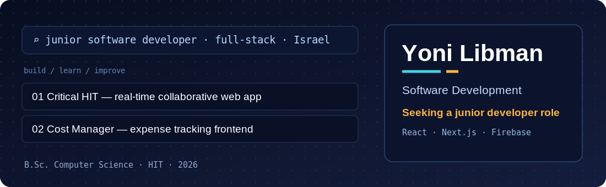
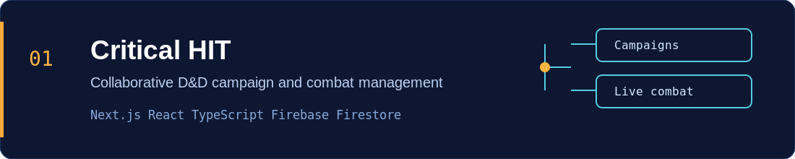
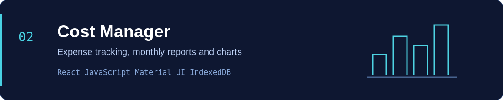
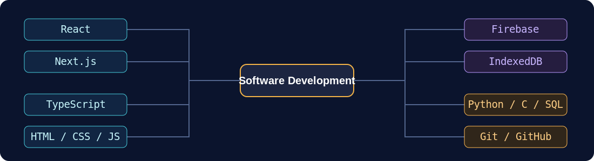

 

<table>
  <tr>
    <td>
      
    </td>
    <td>
      
    </td>
    <td>
      
    </td>
    <td>
      
    </td>
  </tr>
</table>

### About me

I'm a **Computer Science graduate from Holon Institute of Technology (HIT)**, interested in software development and building useful applications. I've independently developed and deployed a real-time web application and collaborated on frontend and NLP projects.

I'm looking for a **Junior Software Developer** opportunity where I can contribute, learn from experienced engineers, and keep developing my skills.

## Selected projects

### 01 — Critical HIT · Independent project

A collaborative Dungeons & Dragons campaign and combat management application, designed, developed, and deployed independently.

- **Real-time collaboration:** Shared campaigns, Google sign-in, invitations, and synchronized combat state using Firebase Authentication and Cloud Firestore.
- **Combat workflow:** Initiative tracking, turn controls, condition durations, concentration checks, and HP management.
- **Interface:** Campaign organization with drag-and-drop ordering and interactive combat controls.

**[Live application](https://critical-hit-app.vercel.app/)** · **[Source code](https://github.com/LB2Man/Critical-H.I.T)**  
`Next.js` `React` `TypeScript` `Firebase` `Cloud Firestore`

### 02 — Cost Manager · Team of three

A client-side expense management application built collaboratively with React.

- Supports transaction tracking, monthly reports, and interactive charts.
- Uses IndexedDB for local persistence and includes currency conversion functionality.

**[Live application](https://cost-manager-frontend-71yh.onrender.com/)** · **[Source code](https://github.com/MatanKarmazin/cost-manager-frontend)**  
`React` `JavaScript` `Material UI` `IndexedDB`

### 03 — Clinical EmotiSupport · Team of three

A machine learning project for multi-label emotion classification in telemedicine messages.

- Used a Bio-ClinicalBERT-based model to classify emotions in patient and caregiver text.
- Evaluated adaptive classification thresholds, achieving **0.84 Micro F1** on the project test dataset.

**[Source code](https://github.com/zvieli/Clinical_EmotiSupport)**  
`Python` `NLP` `Bio-ClinicalBERT`

## Technical stack

**Development tools:** Git, GitHub; AI-assisted development using OpenAI Codex, Claude, GitHub Copilot, and DeepSeek.

## Experience & education

- **QA Tester · uTest (2022):** Manual functional and exploratory testing; documented defects with reproduction steps, screenshots, and supporting evidence.
- **B.Sc. Computer Science · Holon Institute of Technology (HIT), 2026**
- **Languages:** Hebrew (native), English (fluent), Russian (fluent)

---

**Open to junior software development opportunities.**  
[LinkedIn](https://www.linkedin.com/in/yoni-libman-803515399/) · [Email me](mailto:libman.yoni@gmail.com) · [View CV](https://github.com/LB2Man/LB2Man/blob/main/Yoni_Libman_CV.pdf)

